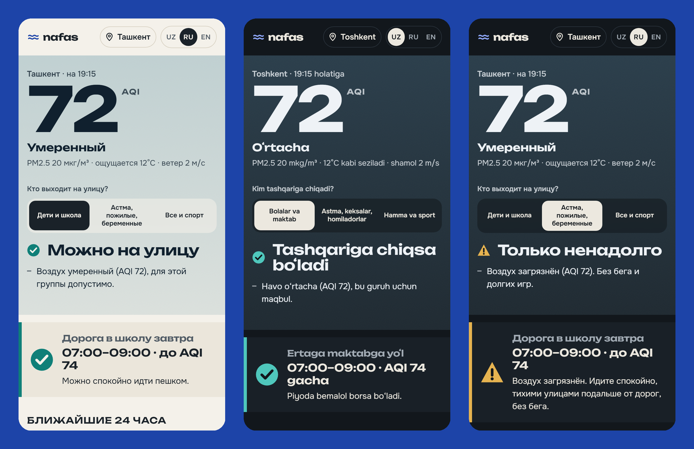

# nafas 🌬

**Clean-air hours for Tashkent families, schools and mahallas.**
*Nafas* means "breath" in Uzbek.

Tashkent's winter smog follows a daily rhythm: it peaks in the morning, right when kids walk to school, and is often 3× cleaner by mid-afternoon. Nafas turns the air-quality forecast into a plain answer for every hour (go outside, only for a short time, or stay inside) for the people who need it most, and spreads that answer through the Telegram chats where mahallas and school classes already talk.

**Live:** https://it-withend.github.io/neighborhood/



## What it does

- **One clear answer for right now**, for three groups: kids & school, people with asthma / elderly / pregnant, everyone & sport. It always says *why* (air, cold, heat, rain, wind).
- **The walk to school, tomorrow morning**: the forecast for 07:00–09:00 with a plain tip. Parents can plan the evening before.
- **Next 24 hours**, hour by hour, with today's best window and school hours marked.
- **What to do now**: windows open or closed, PE inside or outside, mask, inhaler, don't burn leaves.
- **Smog clock**: the average air for each hour of the day over the last 7 days. It shows when the city is dirtiest, for example: "the air at 08:00 was 3.4× dirtier than at 16:00".
- **One tap to Telegram**: send today's plan to a class or family chat, or send a smog alert to neighbours asking them not to burn leaves or trash.
- **Daily 07:00 post** to a Telegram channel through a free GitHub Actions cron job. No server needed.
- **"Smoke nearby?" neighbour reports**: pick what you see (burning leaves, trash, coal smoke, dust…) and your district (all 12 Tashkent districts), then send it to the Nafas bot in one tap. A GitHub Actions job collects the reports every 15 minutes, and the site shows which districts reported smoke in the last 24 hours. Neighbours fill the gap the model can't see. Reports are anonymous: only the type, district and time are stored.
- **Printable A4 poster** for a school entrance or staff room: today's answer for each group, the walk to school, the smog clock and a QR code to the live site, for people without smartphones.
- **Installable and offline-ready (PWA)**: add it to the home screen, and if the connection drops it shows the last saved forecast with its time.
- **Uzbek, Russian, English.** Works on any phone browser with no install, account or tracking. Every answer uses a shape, a word and a colour, so it never relies on colour alone, and it supports keyboard and screen readers.

## How it decides

| Group | "Only for a short time" | "Stay inside" |
|---|---|---|
| Kids & school | AQI > 100 | AQI > 150 |
| Asthma, elderly, pregnant | AQI > 50 | AQI > 100 |
| Everyone & sport | AQI > 100 | AQI > 150 |

AQI is computed from **hourly PM2.5** (Copernicus CAMS forecast) on the **US EPA 2024 scale**. Weather adds its own limits: "feels like" cold and heat per group, rain/snow ≥ 1 mm/h, and wind > 14 m/s. The worst factor decides.

## Run locally

It's a static site with no build step and no API keys.

```bash
python -m http.server 5173
```

Then open http://localhost:5173.

Try the morning post (prints the message without sending it):

```bash
node bot/daily.mjs
```

## Deploy

- **Website:** `.github/workflows/pages.yml` deploys to GitHub Pages on every push to `main`. Enable it once under *Settings → Pages → Source: GitHub Actions*.
- **Telegram:** create a bot with @BotFather and add it as an admin of your channel. Then add the repository secrets `TELEGRAM_BOT_TOKEN` and `TELEGRAM_CHAT_ID` (e.g. `@your_channel`), and put the bot username and channel link into `config.js`.
  - `.github/workflows/daily-post.yml` posts every day at 07:00 Tashkent time.
  - `.github/workflows/collect-reports.yml` collects smoke reports every 15 minutes and commits `reports.json`.
  - You can run both by hand from the Actions tab.

## Project structure

```
index.html, style.css   UI
app.js                  UI logic (rendering, sharing, reports, settings)
core.js                 data loading + decision logic, shared by the site, the poster and the bots
charts.js               smog-clock chart (site + poster)
i18n.js                 Uzbek / Russian / English strings
config.js               bot username, channel link, reports URL
poster.html/.js/.css    printable A4 poster with QR code
sw.js, manifest.webmanifest   offline app shell, install as an app
reports.json            anonymous neighbour smoke reports (written by the collector)
bot/daily.mjs           daily Telegram post
bot/collect.mjs         collects smoke reports from the bot
```

## Built with

HTML, CSS, vanilla JavaScript (ES modules), PWA (service worker + manifest) · Node.js for the bots · qrcode-generator (MIT) for the poster QR · [Open-Meteo](https://open-meteo.com/) Air Quality (Copernicus CAMS), Weather and Geocoding APIs · GitHub Pages and GitHub Actions · Telegram Bot API · fonts Unbounded and Onest (Google Fonts).

## AI disclosure

Built with help from **Claude (Anthropic)**, an AI coding assistant, as allowed by the Neighborhood Hacks rules. The AI wrote most of the code and the translations. The team chose the problem, set the requirements, tested the app with real data and checked the translations.

## Limitations

CAMS is a modelled forecast (about 40 km grid globally), not a sensor in your yard. It shows the city-wide pattern, but it can't see a bonfire next door. Nafas is a planning helper, not medical advice.

## License

MIT
